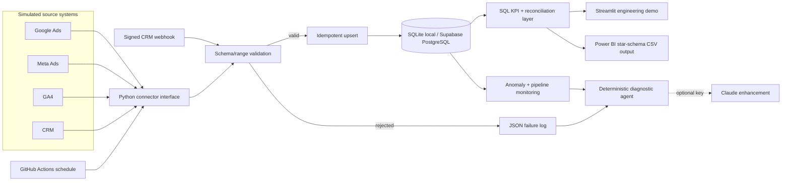

# Architecture

All four source systems in this MVP are **simulators**, not live APIs. Each implements the same connector interface a real authenticated, paginated connector would use.

## Design decisions

- Connector boundary isolates vendor authentication, pagination, rate limiting, and schema mapping.
- Natural composite keys make daily loads idempotent.
- Raw-ish normalized tables keep platform and CRM measures auditable before KPI calculation.
- Attribution is intentionally simple: same date + source + campaign. Production needs an agreed attribution window and identity strategy.
- The local SQLite path makes the demo free. PostgreSQL DDL is included for Supabase.
- The diagnostic path never depends on an LLM: a structured fallback always works.

